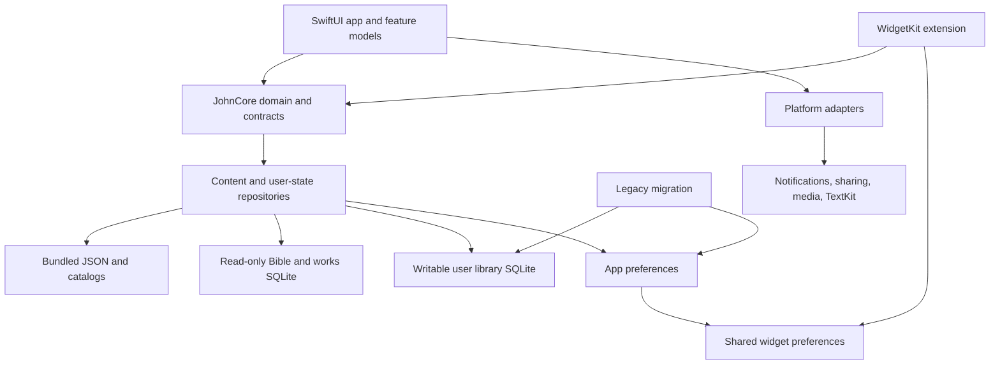

# John 1:1 — 1:1 SwiftUI rebuild for iOS 26

Prepared 5 October 2026. Baseline: repository commit `b64e1fc`, JavaScript app version **1.5.0 (18)**. The native implementation has started. Track tickets in the [native work ledger](native/work-ledger.md).

**User preferences:** use simulator testing for almost all checks. Treat 99% as the intended emphasis. Unit tests are rare exceptions. Use ASD-STE100 Simplified Technical English in plans, model prompts, progress reports, reviews, and final reports. Use short sentences and direct instructions. Preserve code, API names, paths, URLs, and source content.

**Execution status:** L02/L05 foundation is implemented. The app and widget build with Swift 6, and the development shell runs on iPhone 17 Pro simulator. Sol accepted S01. The focused L02/L05 commit and stronger UI checks are in progress. L00 route coverage, L04 state migration, and release/update acceptance remain open. Track current status in the [native work ledger](native/work-ledger.md). The approved baseline remains in force.

## 1. Outcome and model ownership

Rebuild John 1:1 as a native SwiftUI app for **iOS 26.0+ and iPadOS 26.0+**. Keep the current screens, appearance, content, and actions. Keep offline operation and private local state. Preserve installed widgets and saved data during updates. Keep the five tabs in this order: **Today, Read, Saved, Pray, Settings**.

Use the models as follows throughout execution:

| Responsibility | Model | Scope |
| --- | --- | --- |
| Overall architecture and technical decisions | **GPT-6.1 Sol** — `gpt-6.1-sol` | Boundaries, contracts, state ownership, navigation, persistence, migration, rendering approach, dependency choices, acceptance gates |
| All implementation and supporting work | **GPT-6 Luna** — `gpt-6-luna` | Inventory, simulator capture, project setup, assets, data exports, Swift code, platform adapters, simulator flows, build scripts, documentation, fixes |
| Code review and integration review | **GPT-6.1 Sol** — `gpt-6.1-sol` | Inspect complete diffs, validate behavior against the old app, review screenshots and test evidence, identify regressions, approve or return tickets |
| Progress requests and fix requests | **GPT-6.1 Sol** — `gpt-6.1-sol` | Ask Luna for concrete updates, missing evidence, corrections, and follow-up fixes; re-review the resulting changes |
| Release readiness | **GPT-6.1 Sol** — `gpt-6.1-sol` | Assess migration, full parity, physical-device validation, and remaining risks |

Use Sol `high` for architecture and code review. Use Luna `medium` for routine work. Use Luna `high` for migration, text rendering, pagination, and notification scheduling. These are proposed execution settings. No model sessions have been created.

Sol owns decisions and review. Luna writes the code and each requested fix. If a ticket is too broad, Sol divides it into smaller tasks. If a technical choice needs proof, Luna builds a prototype. Sol then makes the decision.

### Meaning of 1:1

1. **Visual parity:** same app-owned colors, fonts, artwork, icon shapes, spacing, layout hierarchy, button labels, content ordering, empty states, and reading presentation on a matched device and text size.
2. **Behavioral parity:** same actions, selection semantics, navigation destinations, return behavior, preference effects, persistence, date handling, and release-mode availability.
3. **Content parity:** identical bundled text, reference mapping, editorial content, attribution, and source links. No rewriting prayers, re-generating illustrations, or substituting Bible translations.
4. **Upgrade parity:** an existing installation retains bookmarks, notes, highlights, progress, favorites, reflections, reader locations, reminder preferences, and widget configurations.
5. **Platform parity:** native keyboards, system sharing, notification permissions, accessibility, safe areas, and lifecycle behavior work correctly on iOS 26.

The default is to preserve the existing app appearance. iOS 26 is the deployment target, not permission to redesign the app around Liquid Glass. Accessibility defects and correctness fixes may improve on the baseline, but each intentional divergence needs a recorded Sol decision and evidence.

## 2. Evidence from this repository

The app uses Expo SDK 55 and React Native 0.83. Expo Router controls navigation. SQLite stores the user library and search data. MMKV stores preferences and other small saved values. The app includes JSON content and a SwiftUI WidgetKit extension. `README.md` is mainly starter documentation. Use the code, `PRODUCT.md`, `docs/ARCHITECTURE.md`, and John release notes as product references.

| Audited item | Observed baseline | Rebuild implication |
| --- | --- | --- |
| Routing | 29 screen route files, excluding `_layout.tsx` | Every route receives a parity record, including less prominent and release-restricted routes |
| Bible editions | `web-ce`, `douay-rheims`, `vulgate`; 73 books per edition | Preserve IDs, canonical ordering, verse labels, chapter divisions, and attribution |
| Search corpus | `assets/bible/bible-search.db`, about 33 MiB, 106,999 verses | Reuse its FTS5 schema and ranking; do not replace it with a simple text scan |
| Verse counts | WEB-CE 35,379; Douay–Rheims 35,811; Vulgate 35,809 | Corpus validation must account for edition-specific verse counts |
| Fathers and Doctors | 26 collections, 271 works, 16,146 sections, 15,108,808 words | Catalog-driven browsing; load one section at a time |
| Works storage | `assets/works/works.db`, about 43 MiB; schema 2; `zlib-json` paragraphs | A Swift zlib decoder must read the existing format exactly |
| Daily reading references | 858 dated entries, 2025-08-25 through 2027-12-31 | Coverage is finite; preserve the missing-date fallback |
| Celebrations | 2,922 entries, 2025-01-01 through 2032-12-31 | A celebration can exist when offline reading references do not |
| Prayer experiences | 27 novenas; four Rosary mystery sets; Seven Sorrows; everyday prayers; five teaching topics | Include the complete catalog and each guide's distinct sequence |
| Widgets | Daily Verse, Verse Countdown, Daily Reading | Preserve all three widget kind strings and existing installed configurations |
| User library | SQLite schema 1: bookmarks, per-verse highlights, notes | Keep existing identifiers and transactional semantics |
| Other user state | Default MMKV instance plus App Group UserDefaults | Native preferences require a legacy importer; UserDefaults cannot decode MMKV by itself |
| Existing verification | 30 test files; two feature Maestro flows | Use their scenarios as simulator checks. Do not port the unit suite by default |
| Local toolchain | Xcode 26.6, build 17F113 | Pin the first reproducible build to the observed toolchain; verify deployed APIs on iOS 26.0 |

The audit read source, database metadata, and one existing Today screenshot. It did **not** interactively verify every route, VoiceOver, update migration, or device widget behavior. Those are mandatory execution tasks, not completed checks.

Existing store screenshots show useful design details. However, the 1.5.0 release notes say they show the old reader. Capture the current app in the simulator before the rebuild. Use these new images for comparison. The release notes record a past submission status. They do not prove current App Store approval.

The latest supplied `AGENTS.md` references `@RTK.md`. It also requires ASD-STE100 Simplified Technical English. Apply these instructions to Luna and Sol. No `RTK.md` was found in the searched locations. The `rtk` executable is installed. If the file becomes available, read it before implementation. This plan does not assume its contents.

## 3. Complete screen and behavior inventory

**All screen implementations below belong to Luna. Every screen receives Sol code and visual review.** Route names describe the existing Expo routes; native routes should become typed destinations while continuing to accept compatible external URLs.

| Existing route | SwiftUI destination | Required parity |
| --- | --- | --- |
| `/` — Today | `TodayView` | Date and season artwork, observance/readings card, suggested Rosary, morning/evening prayer at the existing 17:00 threshold, ongoing novenas, current verse, Sunday preparation, faith/confession links |
| `/read` | `ReaderView` | Book list, chapter grid, continue reading, chapter text, previous/next chapter, settings sheet, verse actions, commentary links |
| `/saved` | `SavedView` | All/bookmark/highlight/note filters, existing sort order, passage snippets, context opening, deletion, temporary undo, empty/error states |
| `/pray` | `PrayerHomeView` | 27 novenas, needs search, Rosary/Seven Sorrows, prayer library, Lectio, Confession, learning links |
| `/settings` | `SettingsView` | Reading, appearance, translation, verse pool/cadence, widget instructions, calendar notices, coverage and attribution |
| `/go-to` | `GoToView` | Every book, current book expanded, current chapter marked, jump without losing reader context |
| `/search` | `SearchView` | Reference parsing, prefix/phrase FTS search, spelling correction, scopes, result highlighting, loading/errors, return to existing reader |
| `/note` | `NoteEditorView` | Existing note load, explicit save, empty-note behavior, errors, keyboard avoidance, exact passage identity |
| `/verse` | `VerseMomentView` | Deterministic current verse, countdown, share text, read in context, dismissible widget guide |
| `/daily?date=…` | `DailyReadingsView` | Exact selected local date, readings and observance, source link, honest missing-reference state |
| `/sunday` | `SundayPreparationView` | Upcoming Sunday including today when it is Sunday, Gospel connections, before/after reflections saved by Sunday date |
| `/passage?reference=…` | `PassageContextView` | Complex reading citation handling, WEB-CE context policy, chapter/reference mappings, explicit context explanation |
| `/lectio` | `LectioView` | Selected or current passage, five steps, back/continue/finish, silent one-minute contemplation timer |
| `/prayers` | `PrayerLibraryView` | Existing groups, prayer titles/content, favorites and their current ordering |
| `/prayer?id=…` | `PrayerDetailView` | Exact prayer wording, source text, favorite actions, related prayer links |
| `/learn` | `TeachingLibraryView` | Five existing Catholic topics, copy, illustrations, links |
| `/teaching?id=…` | `TeachingDetailView` | Editorial summary, Scripture references, CCC citation, Vatican source URL, reflection prompt |
| `/confession` | `ConfessionView` | Examination and guide steps, optional temporary notes, clearing on leave or loss of active state, explicit finish/clear |
| `/share-card` | `ScriptureCardView` | Selected text/reference/edition, warm ivory and evening plum, PNG export, text fallback, preparation/errors |
| `/calendar-notifications` | `CalendarNotificationSettingsView` | Opt-in, time picker, schedule capacity/error handling, dated tap destinations |
| `/pray/[id]` | `NovenaDetailView` | Background, patronage, dates/source, intention, day selection, completion set, continue/reset semantics |
| `/pray/rosary` | `RosaryHomeView` | Suggested mystery set, four sets, artwork, Seven Sorrows, guide/reminder links, release-appropriate media entry points |
| `/pray/rosary-guide?set=…` | `RosaryGuideView` | Full five-decade sequence or distinct seven-sorrow sequence, prayers/repetitions, bead rail, progress announcements, finish/back |
| `/pray/rosary-reminder` | `RosaryReminderSettingsView` | Daily/weekly schedule, local time and weekday semantics, permissions, disable/update behavior |
| `/pray/rosary-media?episode=…` | `RosaryMediaView` | Six catalog entries, official links, separate audio/video states; production playback only for approved direct URLs |
| `/works` | `WorksLibraryView` | Collections, work count, available filters/search, resume card, catalog-only startup |
| `/works/author/[id]` | `WorksCollectionView` | Existing collection order, work kind grouping, title/length labels, attribution |
| `/works/[id]?section=…` | `WorkReaderView` | One-section loading, paginated prose, contents sheet, page/section controls, resume, loading/missing/errors |
| `/commentary/[book]/[chapter]` | `ChapterCommentaryView` | Existing chapter-to-homily index, title/author details, exact work/section opening |

### Cross-screen behavior that must survive

- Read tab resumes book/chapter and position; explicit passage requests take precedence over resume state.
- Search is a stacked screen, not a sixth tab. Closing it returns to the original chapter. Selecting a result reuses the existing Read tab.
- Saved-item opening uses the saved edition. Changing translation refreshes the visible chapter and all subsequent save operations.
- Aa and Settings share one observable preference store; the chapter restyles live while the sheet is open.
- A repeated request for the same passage still triggers contextual positioning. Preserve the intent of `contextRequest` without retaining a stringly typed architecture.
- Selection stays visibly distinct from a saved highlight; active selection does not cover existing highlight fills.
- Bookmarks are passage-based; highlights are per verse with batch grouping; undo restores the original saved item and its timestamps/grouping.
- Daily Reading widget excerpts and liturgical context links use WEB-CE even when the user's rotating verse edition is different.
- Local dates are Gregorian date keys. Locale changes must not silently change the liturgical calendar jurisdiction or underlying date-key calendar.
- Features requiring an external website disclose the existing fallback; core reading and prayer remain usable offline.

## 4. Sol architecture decisions before implementation

Sol writes architecture decision records, or ADRs, under `docs/native/adr/`. Each ADR records a choice and its reason. Luna supplies evidence and implements the choice. The table gives proposed defaults. Resolve them in Wave 1 before dependent work starts.

| Decision | Proposed default | Reason and acceptance condition |
| --- | --- | --- |
| Native project location | `native/John/John.xcodeproj` | Existing `/ios` is generated and ignored. Keep the rebuild tracked and independent of Expo prebuild |
| Deployment and language | iOS/iPadOS 26.0+, Swift 6 language mode, strict concurrency | User's target; no requirement to maintain older OS compatibility in the new target |
| Architecture | Feature-organized SwiftUI app with a small local `JohnCore` Swift package | Shared domain/data code for app and widgets. Simulator checks use the same production code |
| UI state | `@MainActor @Observable` feature models; local `@State` for transient controls | Explicit state ownership and live settings updates. Apple's [Observation framework](https://developer.apple.com/documentation/observation) supplies the observation mechanism |
| Navigation | Typed tab, route, modal, passage request, and URL decoder | Reproduce existing stack behavior and remove ad hoc string routing |
| Storage | Existing SQLite schema for library; typed UserDefaults payloads for small preferences and progress | Least migration risk; no forced SwiftData conversion of an already suitable SQL model |
| SQLite access | Small actor-owned wrapper around system `sqlite3`, prepared statements, explicit transactions | Small dependency footprint. Luna must prove FTS5 and existing databases work on the deployment target before this decision is final |
| Legacy preferences | Narrow native MMKV importer using a compatible MMKV implementation/bridge | Preserve old installs without embedding React Native or Hermes in the new app |
| Long-form text | SwiftUI host; TextKit/UIKit renderer where paragraph interaction or pagination requires it | Preserve rich text and verse hit testing. Apple's [UIViewRepresentable](https://developer.apple.com/documentation/swiftui/uiviewrepresentable) supports a UIKit view inside SwiftUI |
| Appearance | Exact app-owned tokens and artwork; baseline-matching navigation chrome | Prevent automatic platform styling from changing the product's appearance |
| Widget code | Reuse existing Swift views, resources, and timeline behavior; share extracted domain code | Avoid another independent implementation of the verse algorithm |
| Content build | Keep existing data generation scripts; add deterministic native staging/export | Do not re-author or re-download the corpus during the rewrite |
| Networking | Open official links; approved media only | No backend, account, sync service, or new content API is required |

**iOS 26 appearance decision:** standard framework controls can automatically adopt the new appearance when rebuilt. Apple describes this in [Adopting Liquid Glass](https://developer.apple.com/documentation/technologyoverviews/adopting-liquid-glass). Luna must prototype `TabView` and the existing-style bottom bar side by side. Use standard SwiftUI containers wherever they meet the baseline; use a custom SwiftUI tab bar if necessary to preserve its flat background, border, Feather icon geometry, and five-tab layout. Reproduce tab accessibility and safe-area behavior. Do not rely on private APIs or a temporary compatibility flag as the long-term design. System-owned permission dialogs and share sheets should use the OS presentation.

### Proposed component structure

```text
native/John/
  John.xcodeproj
  App/
    JohnApp.swift
    AppEnvironment.swift
    AppRouter.swift
    AppLifecycle.swift
  DesignSystem/
    Theme.swift, Typography.swift, Layout.swift
    Page, Panel, ArtCard, ActionRow, ReaderChrome, Feedback
  Features/
    Today/ Reader/ Search/ Saved/ Settings/
    Readings/ Prayer/ Novena/ Rosary/ Lectio/ Confession/
    Teaching/ Sharing/ Works/
  Platform/
    Notifications/ Sharing/ Media/ Accessibility/
    LegacyMigration/ TextRendering/
  Widget/
    VerseWidget.swift
    DailyReadingWidget.swift
  Packages/JohnCore/
    Package.swift
    Sources/JohnCore/
      Domain/ Content/ Repositories/ Preferences/ Calendar/
  UITests/JohnUITests/
  SimulatorSupport/
    ScenarioConfiguration.swift
    SyntheticStateSeeder.swift
    DiagnosticViews.swift
```

The diagram shows dependencies, not an obligation to create a separate module for every box.



**Boundary rules:** views do not issue SQL. Views do not read MMKV or schedule notifications. Views do not load the full works collection. Keep UI models on the main actor. The main actor controls UI work. Run database and decoding work outside it. Pass immutable `Sendable` values between actors. Keep each SQLite handle and statement in its owning actor. Close statements reliably. Widgets do not read the private library, intentions, or reflections.

### Core contracts Sol defines

- `TranslationID`, `BookCode`, `VerseLabel`, `PassageID`, `PassageSelection`, `ReaderLocation`, `ReadingPreferences`.
- `BibleRepository`: manifests, edition metadata, one book/chapter at a time.
- `SearchRepository`: reference and text query, scope, correction, ranked results, cancellation/stale-result handling.
- `LibraryRepository`: query/save/delete/restore bookmarks, highlights, notes; chapter highlight projection.
- `WorksRepository`: catalog, contents titles, one decompressed section, chapter commentary, reading positions.
- `CalendarRepository`: local date lookup, celebrations, readings, coverage, official URL, upcoming Sunday.
- `PrayerRepository`: existing prayers, teachings, novenas, mystery sets, Seven Sorrows, guide sequences.
- `PreferenceStore`: validated typed reads, observable writes, legacy import; `WidgetPreferenceStore` for the existing shared contract.
- `NotificationScheduler`: serialized reconcile, permission status, owned identifiers, local trigger planning.
- `Clock`/date source, `ShareService`, `MediaService`, `AccessibilityAnnouncer`, `LegacyMigrator`.

Avoid a generic use-case layer for every button. Add an interface when shared code, migration, or a platform service needs it. Add simulator support for repeatable app scenarios. Keep fixture controls and diagnostic views out of production builds. Do not add unit-test targets by default.

## 5. Baseline capture and parity specification

Before screen work, Luna creates `docs/native/parity-matrix.md`. This file lists each feature and the evidence needed to match it. Luna captures repeatable simulator images. Sol reviews the matrix. If the documentation and app differ, Sol records which behavior to use.

Each entry records the route, entry and return paths, initial state, and content. Record layout measurements and accessibility requirements. Link simulator evidence. Include loading, empty, permission denied, invalid input, and storage failure states where applicable.

### Required capture set

- Every route at default text size in light and dark appearance.
- Small supported iPhone geometry, a larger iPhone, and an iPad; matched OS/device between old and new apps wherever possible.
- Reader: WEB-CE prose, Psalm headings/poetry, Song of Songs speakers, an edition without paragraph markers, a long chapter, selected verses with existing highlights, contextual range, Aa sheet, Go to.
- Readings: ordinary weekday, Sunday, Advent, Lent, Easter, year rollover, date beyond readings coverage but inside celebration coverage, date beyond both.
- Prayers: fresh and partial novena, completed novena, Rosary and Seven Sorrows, favorites, each guide's initial/final state.
- Works: empty/missing route, collection grouping, representative commentary, long section, contents sheet, restored page, large text.
- Settings and all text-heavy flows at the largest accessibility text size; evaluate controls as well as content.
- Widgets in every supported family, plus existing installed widgets before and after the native update.

Use a fixed app clock and known saved state. Stop animations during image capture. Keep the status bar consistent. Mask only system regions that change between captures. Do not mask app layout errors. Capture the current native app in the simulator. Old marketing and web images are not the final reader reference.

### Initial visual acceptance budget

Sol calibrates these budgets after a first Today and reader comparison:

- Text, labels, icons, artwork/crop, and element ordering match exactly at the semantic level.
- App-owned colors match source tokens exactly. Geometry differs by no more than about 1 point in major padding, alignment, borders, and control placement at the reference size.
- Text line breaks and poetry indentation match on pinned font/device settings; explain renderer-related differences instead of hiding them in a global diff allowance.
- Start with SSIM at least 0.99 and no more than 1% materially differing unmasked pixels, using a documented pixel tolerance for antialiasing. Treat these as provisional signals, not substitutes for Sol's visual review.
- At accessibility sizes, complete readable content and operable controls take precedence over reproducing known truncation defects. Record the exception and test it.

## 6. Design system and native rendering

Luna extracts design values directly from `src/theme/`, `src/components/companion/Companion.tsx`, reader components, and screen-level styles. Sol reviews a token catalog and representative screenshots before the rest of the UI is built.

| Token/behavior | Baseline to preserve |
| --- | --- |
| Light surfaces | Background `#F6F2EA`; cards `#FFFCF6`; text `#191015`; tint `#745439` |
| Dark surfaces | Background `#191419`; cards `#251D23`; text `#F4F2F1`; tint `#D9BE8D`; error `#F4876B` |
| Spacing | 2, 4, 8, 12, 16, 24, 32, 48, 64 points |
| Companion typography | Lora regular/medium for editorial Scripture/title roles; Space Grotesk family for UI |
| Bible reader typefaces | Georgia for serif; Space Grotesk for sans. Do not assume the reader uses Lora |
| Reader base sizes | Small 16, medium 18, large 21, extra large 24 points |
| Reader line heights | Compact 1.45×, comfortable 1.67×, relaxed 1.9×; preserve rounded source measurements |
| Reader defaults | Medium, comfortable, serif, paragraphs; VoiceOver uses verse-by-verse presentation |
| Reading width | Approximately 34 ems, around 65–70 characters; title and action toolbar align with the column on iPad |
| Companion width | Existing centered content, source max width 740 points and 24-point padding |
| Artwork | Reuse `assets/artwork` files, seasonal mapping, aspect ratios, corner radii, source credits |
| Iconography | Preserve Feather forms where used. Export equivalent vectors/assets with provenance; SF Symbols require explicit visual comparison |
| Launch/icon | John 1:1 name, existing Chi Rho icon/light/dark/tinted variants, plum `#371026` launch field and mark |

Register fonts with their actual PostScript names. Check font weights in the built app. Use `UIFontMetrics` or SwiftUI scaled metrics. Record the base sizes. Do not scale a size twice. Reader text must respond to Dynamic Type. Preserve the source's justified limits on control text size. Check that each control stays usable.

### Scripture renderer prototype: do this early

`ChapterText.tsx` renders flowing paragraphs with tappable verse spans, structural breaks, inline headings, selected ranges, and existing per-verse highlights. A stack containing one SwiftUI `Text` per verse is insufficient for this behavior.

Luna prototypes an attributed TextKit view hosted by SwiftUI, with these requirements:

1. Port `chapterLayout.ts` into a pure layout function, preserving all break kinds `p/m/pi/mi/pc/li/q1/q2/q3/b` and headings `d/s/ms/sp`.
2. Track exact character ranges for each verse across paragraphs, poetry, and inline headings. Labels remain strings, including bridges such as `1-2`.
3. **Preserve JavaScript's UTF-16 offset semantics** for `br` and `hd`. UTF-16 is the character encoding used for these offsets. Use validated UTF-16/`NSRange` mappings. Swift character indices can differ. In the simulator, render and tap text with accented Latin, combining marks, punctuation, and synthetic non-BMP characters.
4. Tap selects a verse; another tap extends/changes the contiguous range according to the existing selection function. Tapping wrapped continuation lines must resolve to the correct verse.
5. Keep four saved highlight colors visible under active selection. Draw the source-equivalent underline/outline for selection, not an opaque selection fill.
6. Use the passage's line height for verse numbers too; the old iOS line-height regression must not reappear.
7. Disable editing and unrelated system text-selection menus in the Scripture renderer; retain deliberate copy/share actions in the toolbar.
8. With VoiceOver enabled, present accessible verse actions and selected states, using the verse-by-verse layout. Preserve heading semantics.
9. Handle geometry and typography changes without losing passage identity. Restore a verse anchor plus within-verse offset; legacy raw `scrollY` is an approximate migration input.
10. Benchmark long chapters and demonstrate that layout does not decode the full Bible or block the UI during unrelated navigation.

Sol reviews the prototype's code, touch behavior, actual screenshots, and accessibility evidence before approving the reader architecture.

### Fathers pagination prototype

The current `PaginatedProse` measures lines. It puts each section into pages that fit the available height. A page can end inside a paragraph. Paragraph gaps remain visible. Luna builds a TextKit/Core Text prototype in a SwiftUI view. Sol selects the approach after simulator review.

Keep page and section controls. Open contents at the current section. Keep readable page announcements and shared text settings. Save each work's position. Recalculate pages after text size, line spacing, typeface, or width changes. Store the section and a text anchor. The anchor identifies the text at the saved position. Accept old `pageIndex` as an approximate position. If page totals differ, Sol must review the cause. Keep pagination. Do not replace it with continuous scrolling.

## 7. Content, search, and deterministic verse contracts

### Resource packaging

- Keep the existing generators in JavaScript/Bun. A Swift app does not require rewriting reliable build tooling.
- Stage the three Bible JSON manifests/books, translation metadata, prayer/teaching/novena catalogs, Rosary sequences, artwork, fonts, calendar JSON, works catalog, SQL databases, and widget corpus/index files.
- Export TS-authored static catalogs to deterministic JSON using build-time scripts; preserve every string, identifier, ordering, and source URL. Generate and verify counts and hashes.
- Reference canonical repository resources or stage them into generated build output; do not commit another duplicate 33 MiB search database and 43 MiB works database by default.
- Supply a resource manifest including schema version, edition IDs, counts, hashes, and coverage. Missing resources fail the packaging check, not the user's first visit.
- Resolve resources through the correct app/extension bundle. Do not assume that package resources and `Bundle.main` are interchangeable.
- Main app resources exclude duplicate intermediate patristic JSON and widget-only data. Widget resources exclude the full works database, private library, and unrelated illustrations.
- Open immutable bundled databases read-only where proven compatible. Keep the user database writable in its existing container. Do not spend launch time copying the works corpus.

### Search behavior

Luna ports `referenceParser.ts` and `searchService.ts`. Keep book aliases and range parsing. Keep accent handling, quoted phrases, and prefix tokens joined with AND. Keep scope filtering and edition isolation. Preserve `bm25` ranking. Use book, chapter, and verse order for equal ranks. Keep the 60-result default limit. Keep spelling correction. Wait 220 ms after typing before the search starts, as the current app does.

Queries use prepared parameters. Limit SQL interpolation to fixed validated scope clauses. Cancel/discard stale responses when typing, switching scope, or changing edition. A failed search must leave reading available. Test `John 3:16`, aliases, quoted phrases, `fiath`, accented Latin, short/empty/punctuation input, missing results, reversed ranges, and the old/new ordering on fixed fixtures.

### Works decompression

The database stores compressed JSON arrays with a **zlib wrapper**. Node `deflateSync` writes them. `fflate.unzlibSync` reads them. Luna opens real sections in the simulator before library UI work. Use a compatible zlib `inflate` decoder. Raw DEFLATE uses a different format. Keep support for old TEXT rows. Check output size and decoding errors. Load only the requested section and contents data.

### Shared verse rotation

The native app and widget must consume one Swift implementation of the audited algorithm:

```text
localMinutes = floor((epochSeconds + timezoneOffsetSecondsAtDate) / 60)
slot = floor(localMinutes / intervalMinutes)
stride starts at 104729, increases by 2 until gcd(stride, scopedCount) == 1
index = positiveModulo(slot * stride + 1729, scopedCount)
```

Cadences: **10, 15, 30, 60, 180, 360, 720, 1440 minutes**. Scopes: `full`, `ot`, `nt`; OT includes deuterocanonical books. Default: WEB-CE, full Bible, daily.

Create reference fixtures from the existing JS and Swift implementations. A fixture is a known input with an expected result. Cover all editions, scopes, and cadences. Include slot boundaries, negative slots, Toronto daylight-saving changes, fractional-offset time zones, travel, and next-boundary calculations. Run these scenarios through the built app and widget code in the simulator. Use a development-only diagnostic view when ordinary UI cannot expose a case. Preserve corpus/index ordering. Use 64-bit arithmetic with explicit overflow and bounds checks.

Do not silently change the existing DST-boundary calculation during a port. If the JS/Swift baseline disagrees or a correctness defect appears, Sol decides one shared behavior, requests a focused Luna fix, and records a cross-platform parity exception. The goal is deterministic agreement, not duplicating conflicting implementations.

## 8. User-data migration: a release-blocking workstream

Production continuity uses the existing app ID **`com.nrsv.verse`**, extension ID **`com.nrsv.verse.widget`**, App Group **`group.com.nrsv.verse`**, and URL scheme **`nrsv`**. Verify actual signed identifiers and entitlements from the baseline archive as well as source config. A different app ID cannot directly read the old app's sandbox.

Use a separate development ID and App Group for visual comparison. Use the production ID and storage settings for simulator update tests. Keep these schemes separate. A different-ID installation cannot prove migration from the old app's container.

### State inventory and destination

| Existing storage/key | Native destination and preservation requirement |
| --- | --- |
| `Documents/SQLite/user-library.db` candidate path | Verify actual baseline container path; open existing SQLite library without changing passage/verse keys, schema-1 rows, highlight batches, or timestamps |
| `bible.translationId`, `bible.rotationInterval`, `bible.verseScope` | Validated typed preferences; preserve valid edition/cadence/scope and existing defaults |
| `bible.reader.location` | Book/chapter, approximate scroll offset, updated timestamp; native anchor added after first reliable layout |
| `bible.reader.textSize`, `.lineSpacing`, `.typeface`, `.layout` | Equivalent enums, existing defaults, synchronized observable store |
| `bible.widgetGuideDismissed`, `bible.reader.selectionHintDismissed` | Preserve dismissed guidance |
| `ignite.themeScheme` | Preserve light/dark/system. This key is written as a raw MMKV string, unlike most JSON payloads |
| `novena.<id>.progress.v1` | Intention, selected day, unique valid completed-day set |
| `vesper.prayer.favorites` | Existing prayer IDs and ordering |
| `vesper.sunday.<date>` | Before/after reflections by original local Sunday date |
| `works.position.v1` | Per-work section/page hints and timestamps; preserve latest-work resume |
| `rosary.reminder.v1` | Enabled state, frequency, local time/weekday, old notification identifier |
| `john.calendar-notifications.v1` | Enabled state and chosen time |
| Shared widget schema 2 | `widgetSchemaVersion`, `intervalMinutes`, `scope`, `translationId`, `abbreviation`, `attribution`; preserve existing numeric/string encoding as observed |
| Temporary Confession notes | Never imported or persisted; transient state only |

The installed dependency documents the default MMKV instance as `mmkv.default` under `Documents/mmkv/`; the local Expo SQLite implementation points its default iOS database directory at `Documents/SQLite`. Treat both as candidates to verify in a real baseline container, not universal hardcoded assumptions.

### Migration algorithm

1. Locate legacy files using the current sandbox root. Confirm MMKV version/configuration, ID, encryption status, actual path, and keys from the baseline binary/container. Do not hand-parse the binary format.
2. Make a recoverable snapshot of the existing SQLite database with the SQLite backup API or a proven consistent checkpoint/copy procedure. Handle WAL/SHM correctly; copying only the `.db` can lose recent rows. Preserve legacy MMKV files too.
3. Read MMKV through a compatible native adapter. Inventory keys without logging private values. Use the same JSON/string normalization semantics as `src/utils/storage` and the feature preference loaders.
4. Stage validated native preferences/progress/reflections. Preserve unknown legacy keys/files and existing valid native data; do not re-import over changes from a previous successful migration.
5. Validate table counts, passage/verse identifiers, note contents, highlight grouping, timestamps, and preference payloads against the fixture. Fail only the affected capability when possible; never initialize an empty library over an unreadable existing database.
6. Commit staged data atomically, persist a versioned completion marker **last**, and then expose the migrated state. Kill/relaunch between each checkpoint must safely resume without duplicate rows or overwrites.
7. Reconcile notification schedules without duplicating old reminders. Read and preserve shared widget preferences; reload only when their effective values change.
8. Retain legacy recovery data and the native importer for users who skip intermediate releases. Do not assume one release is enough to migrate every installed user.

Prefer direct native MMKV import so an intermediate Expo release is not required. If that prototype fails, Sol evaluates a bridge release exporting versioned state plus a native fallback for skipped upgrades. A bridge-only strategy is insufficient unless the update path for older installs is explicitly handled.

### Required migration rehearsal

Start with the old **release-mode** app in an iOS 26 simulator. Add bookmarks and overlapping highlights. Add notes in multiple editions. Add novena progress, intentions, prayer favorites, and Sunday reflections. Set Bible and works positions. Set appearance and reminders. Install the available widgets. Install the same-ID native build over this app. Do not uninstall the old app first. Check every saved value. Check the widget configuration where the simulator supports it. Repeat with interrupted migration, damaged preference payloads, recent WAL writes, and an older supported baseline. Test a fresh install separately. Use synthetic private data. Use a physical device only for behavior that the simulator cannot verify.

Passing a fresh-install test is not evidence that an update preserves user data.

## 9. Widgets, calendar, notifications, sharing, and lifecycle

### Widgets

| Widget kind — preserve exactly | Families — preserve exactly |
| --- | --- |
| `VerseWidget` — Daily Verse | accessory rectangular, inline, circular; system small, medium |
| `VerseTimerWidget` — Verse Countdown | accessory rectangular, inline, circular; system small |
| `DailyReadingWidget` — Daily Reading | accessory rectangular, inline; system small, medium |

Keep original display names, descriptions, supported families, and container appearance. Existing widgets are already SwiftUI: Luna integrates them into the standalone project, extracts shared math/resources, and adapts the preference bridge to native Swift.

Use App Group UserDefaults for the existing widget preference contract. Apple documents shared app/extension containers in [Configuring app groups](https://developer.apple.com/documentation/xcode/configuring-app-groups). Keep private reading state in the app container.

Preserve compact memory-mapped corpus/index access, bounded scheduled verse decoding, countdown timer/progress rendering, and Daily Reading's seven-day midnight timeline. Missing readings show the current dated fallback; never show yesterday's Gospel. Check midnight and year transitions with injected dates.

The OS controls widget execution and may coalesce updates. Pre-supply future timeline entries and reload on effective preference changes; do not promise guaranteed exact delivery at every rotation boundary. Apple's [Keeping a widget up to date](https://developer.apple.com/documentation/widgetkit/keeping-a-widget-up-to-date) explains timeline scheduling and reload budgets.

Accept existing `nrsv://read?book=…&chapter=…&verse=…&contextRequest=…` and `nrsv://daily?date=YYYY-MM-DD` links. Validate all parameters, queue cold-start destinations until migration/preferences are ready, and support foreground repeated taps. Keep widget kind identities stable across updates; confirm installed instances persist in a same-ID device rehearsal.

### Calendar and reading references

- Port `calendar.ts` date/season/Sunday logic and its existing behavioral fixtures.
- Use local Gregorian dates and the existing United States Roman Rite calendar, including Sunday Ascension assumptions.
- Keep season artwork mapping and the difference between celebration and readings coverage.
- Preserve the WEB-CE context policy for liturgical citations, including Joel chapter mapping, Esther lettered additions, one-chapter books, and complex references.
- Link to the official USCCB page when full lectionary wording or missing references require it. Do not generate unlicensed lectionary text or claim every local jurisdiction is covered.

### Local notifications

Implement with `UNUserNotificationCenter`; no APNs/push entitlement, push token, or server is needed for the existing feature set.

- Ask permission only when the user enables notices. Read permission status on foreground and present the existing denial/recovery state.
- Rosary: daily or weekly local calendar trigger; existing weekday mapping; tapping opens the Rosary home.
- Calendar: default disabled, 08:00; up to 30 dated notices; capacity calculation preserves other reminders and the existing reserved room policy.
- Serialize schedule reconciliation and setting changes. Remove only identifiers owned by the affected feature. Preserve unchanged schedules; rollback partial failures.
- Refresh on launch, foreground, significant date/timezone changes, and hourly while active, with owned lifecycle timers. Do not rely on background execution to replenish a finite schedule.
- Preserve the dated destination in notification payloads and accept legacy payload keys/identifiers during upgrade.
- Handle cold-start responses once, queue until ready, and avoid navigation duplication.
- Retain the app's honest requirement to reopen periodically to extend its finite calendar schedule.

### Sharing and media

Luna uses native activity-sheet presentation for text and exported PNGs. Port the exact Scripture-card composition, two bundled backgrounds, passage reference, translation, wordmark, and long-text font rule. Export at the current **1080-pixel width**, with the full measured height; verify preview and export match. Handle artwork readiness, text fallback, cancellations, errors, temporary-file cleanup, and iPad presentation.

Use AVKit/AVFoundation for the existing separate media states. Preserve the six official catalog links and release gating. Unapproved direct streams and development test clips must not become available in a production build. Background playback, microphone recording, and picture-in-picture are not part of the current product contract.

### Lifecycle and accessibility

- Active UI timers recompute from the injected clock/deadline rather than depending on elapsed callback counts. Lectio's quiet minute remains silent.
- Confession notes are in-memory only and clear on guide exit, finish, external link opening, and transition away from active state, matching the current conservative behavior. Avoid putting them in restoration, crash breadcrumbs, screenshots used for testing, or logs; use synthetic notes for verification.
- Reconcile reading/settings state on foreground, preserve unsaved-editor behavior from the baseline, and save position at reliable lifecycle checkpoints.
- Add VoiceOver labels, selected states, headings, adjustable/progress values, and announcements for actions/results/errors. Test focus order and actual speech on device.
- Verify Dynamic Type, larger content size, dark contrast, Reduce Motion, Reduce Transparency, touch targets, keyboard avoidance, and iPad widths. Source notes identify AX5 Search-scope wrapping and Rosary-label truncation; fix rather than reproduce these defects, with documented parity exceptions.
- Audit real localized string usage separately from scaffold locale files. Port shipped localized behavior and RTL layout where it exists; do not claim the app has complete translations merely because seven resource files are present.

## 10. Execution waves, dependencies, and review gates

Each ticket is a scoped Luna implementation task unless explicitly marked **Sol**. The reviewer for every Luna ticket is **Sol**. Tickets may be split further if their evidence or file scope is too broad. The first usable milestone is a vertical slice: launch → Today/Read → Search → save → Saved → relaunch, with native widget integration.

| Wave / ticket | Owner | Deliverable and required evidence | Dependencies |
| --- | --- | --- | --- |
| **0 — L00** | Luna | Complete route/state inventory, fresh baseline build/captures, identifiers/entitlements inventory, synthetic legacy fixture; reconcile stale screenshots/docs | None |
| **0 — S00** | Sol | Review inventory; freeze parity baseline, scope, intentional exceptions, initial test matrix | L00 |
| **1 — L01** | Luna | Three short prototypes: paragraph verse selection, paginated works text, same-ID legacy MMKV/SQLite read; demonstrate real data | S00 |
| **1 — S01** | Sol | ADRs for modules, routes/state, storage/import, renderer/pagination, resource packaging, iOS 26 chrome; published contracts | L01 |
| **2 — L02** | Luna | Tracked Xcode project, app/widget/UI automation targets, simulator schemes, entitlements, Swift 6 settings, CI build, clean launch | S01 |
| **2 — L03** | Luna | Deterministic resources/catalog export, fonts/icons/artwork, count/hash verification, SQLite FTS5 and zlib compatibility proof | S01, L02 |
| **2 — L04** | Luna | Typed domain, repositories, injected clock, preference store, versioned migration; interrupted simulator updates preserve the library | L02, L03 |
| **2 — L05** | Luna | Theme/components, accessible five-tab shell, typed push/sheet routing, URL decoding, baseline Today/reader chrome comparisons | L02, S01 |
| **Gate A** | Sol | Review L02–L05; build on pinned toolchain, migration safe, resources exact, UI foundation matches | L02–L05 |
| **3 — L06** | Luna | Reader browse/book/chapter navigation, continue reading, previous/next, Go to | Gate A |
| **3 — L07** | Luna | Scripture rendering, verse layout, selection, context positioning, highlights; simulator taps and prose/poetry screenshots | L06, L01 |
| **3 — L08** | Luna | Live Aa sheet and Settings reading controls, Dynamic Type, edition switching, location persistence | L07, L04 |
| **3 — L09** | Luna | Search parser/FTS/correction UI, debounce/cancellation, correct back/result navigation | L06, L03 |
| **3 — L10** | Luna | Bookmark/highlight/note repository operations and selection toolbar, copy/text share, confirmation/error announcements | L07, L04 |
| **3 — L11** | Luna | Saved filters, context opening, note editor, delete/undo; full old Maestro journey on native app | L09, L10 |
| **3 — L12** | Luna | Verse Moment view, shared deterministic rotation, native shared preferences, three widgets, deep-link cold/warm handling | L04, L05, L06 |
| **Gate B** | Sol | Review simulator evidence for reading, reference fixtures, existing-user library, widget identities, fresh/upgrade offline flows | L06–L12 |
| **4 — L13** | Luna | Calendar/readings/reference mapping, dated daily page, Sunday prep/reflections, coverage fallbacks | Gate B |
| **4 — L14** | Luna | Complete Today page with date/season/verse/prayer/ongoing-novena behavior | L13; available catalog export |
| **4 — L15** | Luna | Everyday prayers/favorites, Learn and Teaching screens, source links | Gate B, L03 |
| **4 — L16** | Luna | All 27 novenas: home/needs search/detail, intentions/day completion/reset, migrated progress | Gate B, L04 |
| **4 — L17** | Luna | Rosary home/guide, all four sets and Seven Sorrows, correct prayers/repetitions/artwork, adaptive bead progress | L15, L03 |
| **4 — L18** | Luna | Lectio five-step flow and timer; simulator leave/background/relaunch checks for temporary Confession notes | Gate B, L15 |
| **4 — L19** | Luna | Scripture-card preview/export, both backgrounds, long passages, iPad system sharing, cleanup | Gate B, L03 |
| **Gate C** | Sol | Review all devotional/content flows; screen comparisons, source/content identity, persistent versus ephemeral state | L13–L19 |
| **5 — L20** | Luna | Works library/collection/commentary routing, kinds/grouping, counts, catalog-only browsing | Gate B, L03 |
| **5 — L21** | Luna | Works repository and renderer, zlib/TEXT compatibility, contents/pagination/section controls/resume; long-section simulator checks | L20, L01 |
| **5 — L22** | Luna | Rosary/calendar notification settings and serialized schedules, legacy reminder reconciliation, dated tap destinations | L13, L17, L04 |
| **5 — L23** | Luna | Release-gated media catalog/native players, lifecycle cleanup, external links, production/development checks | L17, L03 |
| **5 — L24** | Luna | Complete Settings, widget instructions, attribution/licenses, calendar coverage, icon/launch/appearance review | L08, L12, L22 |
| **Gate D** | Sol | Approve long-form library, notifications, media gating, complete settings and attribution | L20–L24 |
| **6 — L25** | Luna | All-route simulator comparisons; light/dark/Dynamic Type/iPad checks and fixes; limited device checks for unsupported behavior | Gates C, D |
| **6 — L26** | Luna | Simulator performance and memory checks; offline, damaged/missing data, lifecycle, date/timezone scenarios; fix measured faults | Gates C, D |
| **6 — L27** | Luna | Same-ID release-mode simulator updates from supported old builds; library/preferences/reminders/widget checks; interrupted update recovery | L25, L26 |
| **Gate E** | Sol | Full code/integration review; no missing routes, content discrepancies, migration loss, or unexplained visual differences | L25–L27 |
| **7 — L28** | Luna | Release archive/signing verification, privacy manifest, fresh store screenshots, reproducible build/release instructions, final evidence bundle | Gate E |
| **7 — S02** | Sol | Final readiness assessment and remaining-risk report; direct any last Luna fixes and re-review | L28 |

### Dependency and sequencing policy

Do not build 29 polished screens on top of an unproven renderer or migration strategy. L01 and S01 precede screen work. Once contracts are approved, independent catalog-based screens can proceed alongside the reader, but integration always follows the same gates.

Start with one Luna implementation worker and one Sol architecture/review role. If parallel implementation is later used, limit it initially to two Luna workers with disjoint feature directories. Sol controls assignments and integration. Shared router, theme, schema, resource manifest, and project files have one writer at a time. Add parallelism only when it reduces a measured dependency bottleneck; do not dispatch every screen at once.

Typical separate assignments after Gate A: Luna worker A handles Reader/Search/Saved; Luna worker B handles exported-content devotional screens using frozen contracts. Architecture and review remain Sol-owned. Complex renderer, migration, and shared-widget changes are reviewed before dependent screens consume them.

No calendar or cost promise is made from code size alone. After L01, estimate the remaining work from prototype results and observed ticket throughput. Reserve an explicit final iteration for fidelity, device checks, and update rehearsals; implementation completion alone is not the finish line.

## 11. Sol → Luna workflow: updates, reviews, and fixes

Select the actual model when a task starts. A prompt cannot change the model that runs it. Use `gpt-6-luna` for implementation. Use `gpt-6.1-sol` for architecture and review. This document does not create chats, agents, monitors, or branches.

### Ticket lifecycle

```text
Ready → Luna implementing → Luna evidence ready → Sol reviewing
                                      ↑                 |
                                      └── Luna fixes ←──┘
                                                        |
                                                   Sol accepted
```

1. Sol supplies one ticket, approved contracts, exact source references, allowed write scope, dependencies, and behavior-specific acceptance criteria.
2. Luna implements a coherent change, builds/runs relevant checks, and supplies artifacts. It may ask Sol to resolve a contract question; it should keep doing independent authorized work.
3. Sol requests an update when a dependency is waiting, progress stalls, or a build/check fails. Ask for changed files, working behavior, remaining work, blockers, and exact evidence; avoid repeated status requests without new information.
4. Sol reviews the diff against the source behavior and acceptance criteria. Sol checks simulator flow steps and their results. Sol reviews screenshots and recordings. A build alone does not prove behavior.
5. Sol sends concrete fixes to Luna with severity, location, triggering scenario, expected behavior, and how to verify it. Luna fixes them and returns evidence.
6. Sol re-reviews the changed diff and relevant checks. Accept only when required evidence is present. Check an accepted ticket's integration before starting work that depends on it.

Every handoff records the reviewed commit SHA and native toolchain. If code changes after review, the old acceptance does not apply to the changed portion. Keep the original parity baseline frozen.

### Implementation prompt template — GPT-6 Luna

```text
You are implementing ticket <ID> in the John 1:1 iOS 26 SwiftUI rebuild.
Use GPT-6 Luna for this work. Architecture and review belong to GPT-6.1 Sol.

Read docs/swiftui-ios26-rebuild-plan.md, applicable repository instructions,
the approved ADRs, and these exact old-app sources: <paths>.
Use ASD-STE100 Simplified Technical English in reports and documentation.
Use short sentences. Give one action per instruction.
Approved contracts: <interfaces, models, ownership decisions>.
Allowed write scope: <files/directories>. Dependencies: <accepted tickets/SHAs>.

Build the existing behavior and appearance 1:1. Use the approved content,
identifiers, theme, routing, storage, and resource contracts.
Do not silently change shared contracts, content, schemas, or dependencies.
Acceptance scenarios: <concrete Given/When/Then cases>.
Run checks in the iOS 26 simulator by default.
Use real app flows, screenshots, recordings, and update/relaunch scenarios.
Do not add unit tests unless Sol states why a specific simulator check is insufficient.
Required verification: <build, simulator scenario, screenshots, expected results>.

Return changed files, behavior delivered, exact test/build results,
screenshots/artifact locations, unresolved concerns, and the reviewed commit SHA.
If a contract decision is missing, report it to Sol with evidence and continue
work that does not depend on that decision. Do not claim unrun checks passed.
```

### Architecture prompt template — GPT-6.1 Sol

```text
Own overall architecture for the John 1:1 1:1 SwiftUI rebuild on iOS 26.
Read the rebuild plan, source audit, parity matrix, and Luna's prototype evidence.
Use ASD-STE100 Simplified Technical English in plans, prompts, and reports.
Use simulator evidence for almost all acceptance checks.
Decide domain boundaries, typed navigation, state ownership, persistence,
legacy import, text rendering/pagination, widgets, resource packaging,
concurrency, and failure behavior.

Write concise ADRs and implementation contracts. Identify blocking uncertainty.
Ask Luna for a simulator proof where needed. Route all implementation,
simulator flows, baseline capture, build scripting, and fixes to GPT-6 Luna.
Define specific acceptance gates and evidence; review subsequent contract changes.
```

### Review prompt template — GPT-6.1 Sol

```text
Review Luna ticket <ID>, commit <SHA>, against the approved architecture,
parity matrix, and these baseline sources/artifacts: <paths>.
Use ASD-STE100 Simplified Technical English in the review and fix requests.
Read the full diff and affected callers. Read build output and simulator flow results.
Inspect screenshots and recordings. Ask Luna for missing simulator evidence.

Check correctness, offline behavior, edition/passage identity, date handling,
migration safety, concurrency, memory/resource use, navigation return behavior,
accessibility, visual fidelity, and realistic error paths as relevant.
Confirm evidence corresponds to this commit and the pinned device/toolchain.
Prefer simulator checks. Request a unit test only for a specific case that
the simulator cannot reasonably verify. State the reason in the ticket.

Return ACCEPTED or CHANGES REQUIRED. For each finding, give severity,
file/location, reproduction scenario, expected result, and verification needed.
Send implementation and missing evidence requests to GPT-6 Luna.
Do not implement routine fixes yourself. Re-review Luna's correction before acceptance.
```

### Progress request template — Sol to Luna

```text
Update ticket <ID>: list behavior already working, files changed,
checks actually run and their results, remaining work, and any blocking decision.
Provide the latest screenshot or failing diagnostic relevant to <dependency>.
Continue the assigned work after reporting unless a required decision blocks it.
```

### Fix request template — Sol to Luna

```text
Ticket <ID> requires this fix before acceptance:
Severity: <P0/P1/P2/P3>. Location: <file and symbol>.
Trigger: <exact state and user action>.
Observed: <failure>. Expected: <baseline/approved behavior>.
Make the correction within <scope>. Preserve <relevant invariant>.
Verify in the simulator with <exact flow, screenshot, or update scenario>.
Return the changed diff, results, and new commit SHA for re-review.
```

### Evidence bundle and work ledger

Luna maintains `docs/native/work-ledger.md` with ticket status, model owner, dependencies, implementation SHA, Sol verdict, fix requests, and evidence paths. Suggested evidence layout: `build/native-evidence/<ticket>/<sha>/` for logs, `.xcresult`, screenshots, and performance samples; do not commit large DerivedData trees.

Luna's ticket report must distinguish **implemented**, **checked**, and **still unverified**. Sol's acceptance refers to the actual checks, not a generalized claim that the feature is complete.

## 12. Simulator testing and finish criteria

### Test policy

Use the simulator for almost all verification work. This is the user's stated preference. Make simulator evidence the default acceptance requirement for every Luna ticket. Do not create a unit-test suite as a standard phase. XCUITest and Maestro are UI automation tools. They can run user actions in the simulator. They are not unit tests.

Use manual simulator checks for new interaction details. Add automation for important repeatable flows. Keep fixture setup small. Use the real production renderer, repository, and service code. Do not build a second version of the feature inside a test harness.

Use a unit test only for a narrow case that a simulator scenario cannot reasonably verify. Sol must state the reason. Sol must keep the scope small. Luna implements the check. This is an exception, not a standard requirement for each feature. Build checks and resource count/hash checks are still required. They do not replace simulator testing.

### Simulator setup

1. Create a dedicated iOS 26 simulator for this rebuild.
2. Add a small iPhone, a larger iPhone, and an iPad to the test set.
3. Pin the OS version and device type in each evidence record.
4. If the installed runtime is newer than iOS 26.0, add a deployment-floor check on 26.0 before release.
5. Use a separate bundle ID for old/new side-by-side visual checks.
6. Use the same production bundle ID for update tests.
7. Seed synthetic saved items and preferences through a development-only scenario loader.
8. Inject a known date and time zone into the app for date-dependent checks.
9. Keep scenario controls out of the production UI and archive.

An injected app clock does not change the simulator's OS notification clock. Test notification triggers with the actual simulator clock. Use short delivery intervals only in development scenarios. Verify production schedule fields separately. Do not use a simulated app date as proof of OS delivery.

### Default ticket check loop

1. Build the changed app for the simulator.
2. Launch the required starting state.
3. Perform the ticket's user actions.
4. Check the visible result and relevant saved state.
5. Capture a screenshot or recording.
6. If the change affects saved data, terminate and reopen the app.
7. If the change affects layout, check dark mode and large text.
8. If the change affects navigation, check both entry and return paths.
9. Send the evidence and build SHA to Sol.
10. If Sol finds a fault, repeat the affected scenario after Luna fixes it.

Use the installed simulator's supported controls for appearance, text size, links, and app lifecycle. Use Airplane Mode or a controlled network block for offline checks. A mocked network flag alone does not prove offline operation.

### Required simulator scenarios

| Area | Simulator evidence |
| --- | --- |
| Reading | Open all three editions. Jump to prose, poetry, headings, and long chapters. Select wrapped verses. Extend a selection. Keep saved highlights visible. Change Aa settings live. Reopen at the saved position |
| Search | Enter references, aliases, quoted phrases, misspellings, and Latin text. Switch scope and edition. Type quickly. Check result order. Close Search. Open the same result twice |
| Library | Save a bookmark, each highlight color, and a note. Check Saved filters. Delete and undo. Reopen the app. Open saved context in its original edition |
| Calendar | Use known dates for seasons, Sunday, year rollover, and missing coverage. Check Joel/Esther mappings. Check the correct USCCB link and dated fallback |
| Prayers | Find all catalog entries. Check needs search. Set an intention. Complete novena days. Reopen progress. Favorite prayers. Save Sunday reflections |
| Guides | Complete Rosary and Seven Sorrows. Check their distinct sequences. Run Lectio's quiet timer. Leave Confession and background the app. Verify notes clear |
| Works | Open each collection. Load real compressed sections. Open contents. Change text size. Page across sections. Reopen at the saved section. Check a long section and missing ID |
| Rotation | Run known clock/edition/scope/cadence scenarios in the actual app and widget code. Check reference-fixture results and the next change date |
| Widgets | Capture available families. Check preference changes, links, date boundaries, and update retention where supported. Record simulator limits |
| Notifications | Enable/deny/change/disable each feature. Check pending schedules. Preserve the other feature's requests. Tap delivery. Check cold/warm dated navigation |
| Sharing/media | Open text and PNG sharing. Compare export with preview. Check long text and iPad presentation. Test production media gating and player cleanup |
| Failure handling | Seed damaged or missing data through development controls. Check readable recovery states. Verify that valid saved data remains intact |
| Upgrade | Seed the old app. Install the new same-ID build without uninstalling. Check all state. Interrupt migration. Relaunch. Repeat the update. Verify no duplicate or overwritten state |
| Visual/accessibility | Compare all routes in light/dark appearance. Use the largest text size. Check the accessibility tree, labels, selected states, focus order, small phones, and iPad widths |

Use old JS tests as a source of expected behavior. Reuse their fixtures where useful. Do not port them all into Swift unit tests. The two Maestro flows provide useful simulator sequences. One covers search, selection, copy, bookmark, highlight, note, Saved, deletion, and undo. The other covers edition switching, Latin search, novena search, and progress. Check stale Today assertions against the current app before using them.

### Small physical-device check set

Use a device when the simulator cannot prove a required behavior. Keep this set limited. Check actual VoiceOver speech. Check installed widgets across a signed update. Check notification delivery under real OS conditions. Check signing and entitlements. Record each reason. Simulator evidence remains the main review input. A unit test cannot replace these device checks.

### Initial performance targets

These are proposed budgets to calibrate on a named physical reference device after the first vertical slice, not measurements of the current app:

- Cold launch to useful offline Today content: approximately 1 second median and at most 1.5 seconds at p95 in a release build, excluding first migration/system permission UI. Record migration duration separately.
- Chapter display and common FTS response after debounce: target under 150 ms at p95; measure decode/query and UI presentation separately.
- No full works/Bible decode on launch. Works browsing must not initialize its text database or block Today.
- Long chapters/sections must scroll/page without sustained dropped frames. Measure Instruments traces rather than adding speculative caches.
- Widget memory/resource use stays at or below the baseline on equivalent families; instrument the real extension, not only previews.
- Release archive, installed resources, and memory footprint are reported; avoid shipping duplicated corpora or caches. Choose a measured budget after baseline capture.

Luna instruments and fixes bottlenecks; Sol decides tradeoffs from evidence. Use bounded caches and section-level decompression. Repeat broad tests only after changes, failures, or unresolved concerns justify them.

### Release cannot be declared ready until

1. All 29 route entries and their required states are implemented and accepted by Sol.
2. All bundled content counts/hashes and source/attribution text match the frozen baseline; deliberate content updates are separate changes.
3. The native archive builds reproducibly, includes app and all three widgets, has correct IDs/App Group/URL scheme, and uses deployment-compatible APIs.
4. The core offline journeys pass in a release build with networking unavailable.
5. Same-ID update preserves the seeded library, all persistent preferences/progress/reflections, reminders, and installed widget configurations without uninstalling.
6. Migration interruptions recover safely; unreadable legacy data is never overwritten by a fresh empty store.
7. Reader paragraphing/poetry/selection/highlights and Fathers pagination meet the approved behavior and visual criteria.
8. All-route visual review is complete; large text, dark mode, small phones, and iPad layouts remain readable and usable.
9. Real-device VoiceOver, notification tapping, widget behavior, lifecycle clearing, and native sharing are checked. Simulator screenshots alone do not satisfy these requirements.
10. Privacy/required-reason API declarations and included dependencies are reviewed; the product's private, local-state claims match behavior.
11. Release-mode media availability matches the current approved catalog. No test clips or placeholder playback become production content.
12. Fresh App Store screenshots reflect the rebuilt current UI, and Sol's final report names any accepted exceptions.

The intended result is a complete native replacement of the current iOS app. Android and web remain outside this implementation scope; the existing Expo project continues to serve as the reference until the native app has passed the full update and parity gates.

## 13. Main risks and concrete mitigation

| Risk | Mitigation / proof owner |
| --- | --- |
| Rich paragraph text cannot preserve tap-to-verse behavior with naive SwiftUI text | Luna TextKit prototype in L01; Sol chooses renderer before screen work |
| Native update loses MMKV values or recent SQLite writes | Luna tests the native importer and backup in same-ID simulator updates. Interrupt migration and reopen. Sol blocks release if data is lost |
| iOS 26 chrome changes the app's appearance | Luna matched shell prototype and snapshots; Sol fixes native/custom boundary in ADR |
| Swift offsets change headings, poetry, or tap ranges | Luna renders and taps UTF-16 fixtures in the simulator. Sol reviews range mapping |
| Works appear empty or crash because decompression framing differs | Luna proves zlib-wrapped JSON and legacy TEXT decoding using real database rows in L03 |
| App and widgets select different verses | Use shared Swift math and exact pool order. Luna checks known clock scenarios in the simulator |
| Calendar references treated as complete through 2032 | Preserve separate readings/celebrations coverage and correct dated fallbacks |
| Concurrent workers break shared contracts or project files | Sol-controlled contracts and one writer for shared files; disjoint Luna tasks |
| Passing tests hides visual or accessibility regression | Mandatory old/new screenshots, Sol visual review, and actual-device accessibility checks |
| Release archive differs from debug behavior | Release-mode UI/media/permission/update tests and reviewed final SHA/archive |

## 14. First concrete assignments

1. **GPT-6 Luna — L00:** build and inspect the current native baseline; complete the 29-route/state matrix, capture current screenshots, seed the legacy fixture, and verify binary identifiers/storage paths.
2. **GPT-6.1 Sol — S00:** review the matrix, freeze baseline/acceptance rules, identify source/runtime discrepancies, and request any missing evidence from Luna.
3. **GPT-6 Luna — L01:** prove paragraph selection/highlight rendering, Fathers pagination/zlib decoding, and native MMKV/SQLite import with real baseline fixtures.
4. **GPT-6.1 Sol — S01:** choose architecture and publish ADRs/contracts based on those proofs; send Luna the project/resource/storage/shell tickets.

This sequence puts the two most consequential technical risks and the visual fidelity decision ahead of broad screen implementation, while retaining the requested model split for the entire rebuild.
