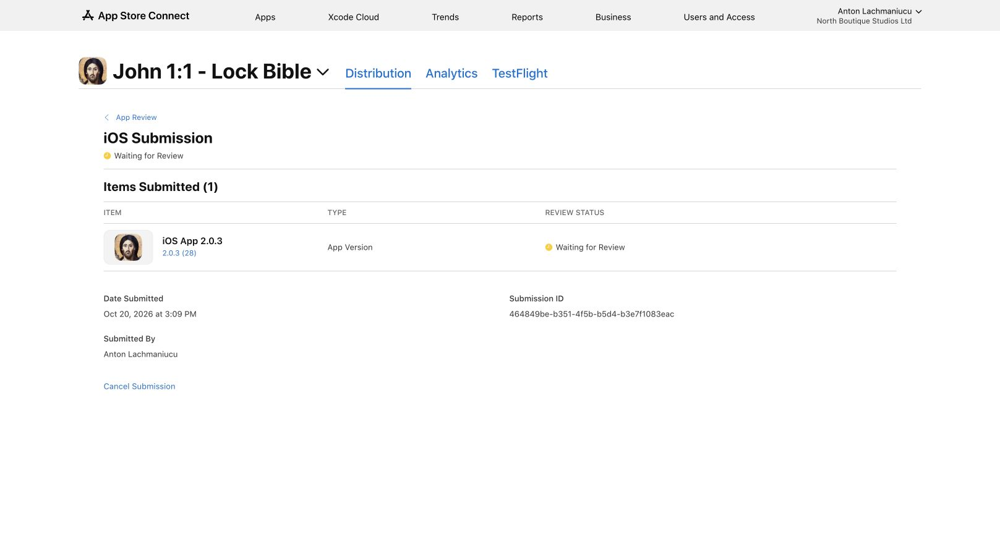

# My Saints release — 2026-10-20

## Release inputs

- Source commit: `358ef75`.
- iOS: John 1:1, `com.nrsv.verse`, **2.0.3 (28)**.
- Android: John 1:1, `com.john.bible`, **1.0.3 (4)**.
- Features: personal saint pages and private notes, My Saint widgets, and feast preparation with optional local reminders.
- The catalog contains nine saints and 15 explicit calendar mappings. Existing Vatican News and Ruthenian Byzantine Catholic calendar features remain included.

## Validation

- Xcode Release archive and App Store distribution export passed.
- App and widget distribution signatures passed. Debug access is disabled. Both use the production App Group and build 28.
- Package checks passed for fonts, licenses, privacy manifests, launch assets, and all three app icon variants.
- The My Saints catalog in each app matches the reviewed source bytes. The iOS widget reads public data from the shared App Group.
- Signed Android bundle checks passed: upload certificate, bundletool validation, production metadata, and 16 KB native library alignment.
- All 21 Android release unit tests passed. Release lint reported 0 errors, 0 fatal issues, and 46 warnings.
- Earlier feature checks passed: 50 Swift core tests, one iOS persistence UI test, three Android device tests, and the notification failure harness.
- iOS Home Screen widgets and the main personal pages were checked in the simulator. Android widget layouts and tap navigation were checked with the widget-host test.
- Physical-device notification delivery, accessibility text sizes, iOS Lock Screen and tinted widgets, and Android real launcher resizing were not checked in this session.

Public verification reports are in [evidence/my-saints-release-2026-10-20](evidence/my-saints-release-2026-10-20).

## Store status

- Apple: **Waiting for Review**, submitted October 20, 2026 at 3:09 PM EDT. Version **2.0.3 (28)**. Submission ID `464849be-b351-4f5b-b5d4-b3e7f1083eac`. This replaces the earlier build 27 submission.
- Google: version **1.0.3 (4)** is uploaded and saved for production. Automatic quick checks are still running. Review submission is not yet confirmed.
- Google reports one non-blocking warning for missing native debug symbols in the bundled third-party library. Its device support is unchanged.

## Release policy

Keep the existing store settings: manual release after Apple approval; full Android rollout after Google approval, with managed publishing off.
